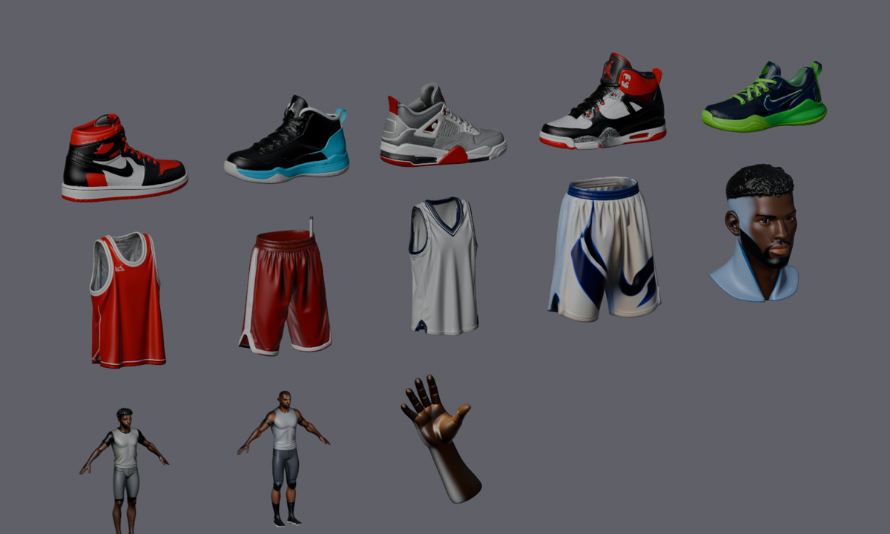
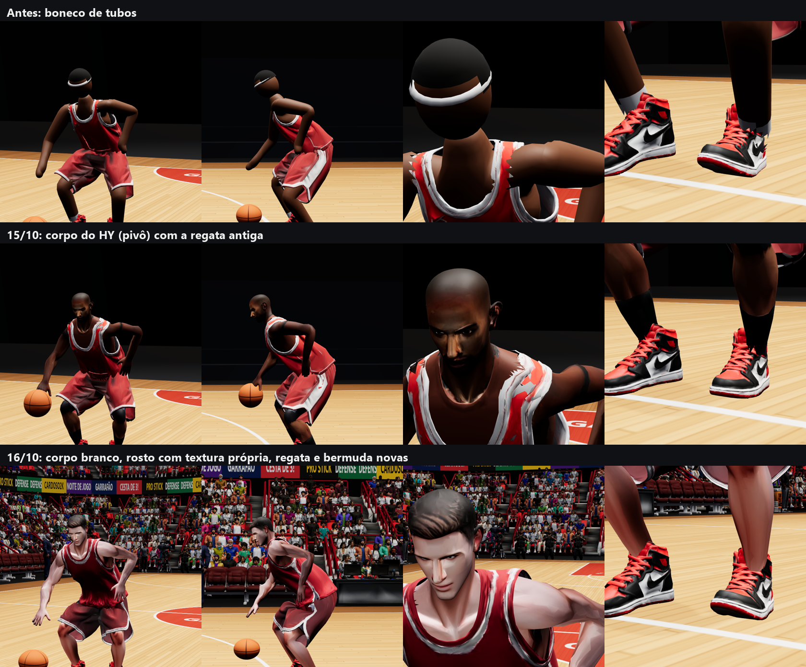
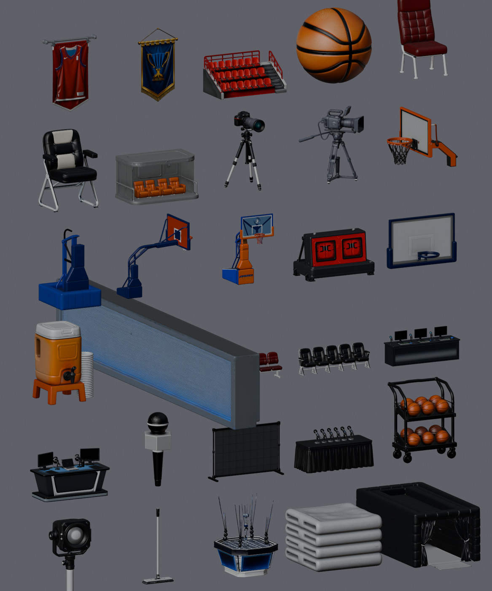
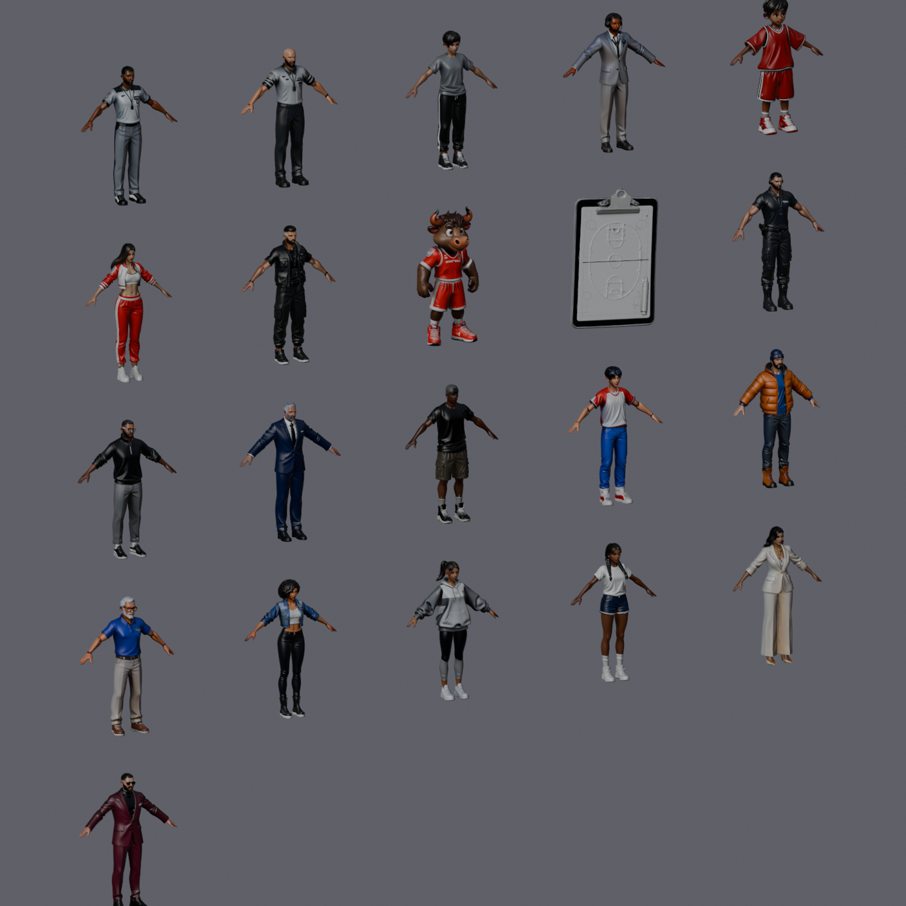
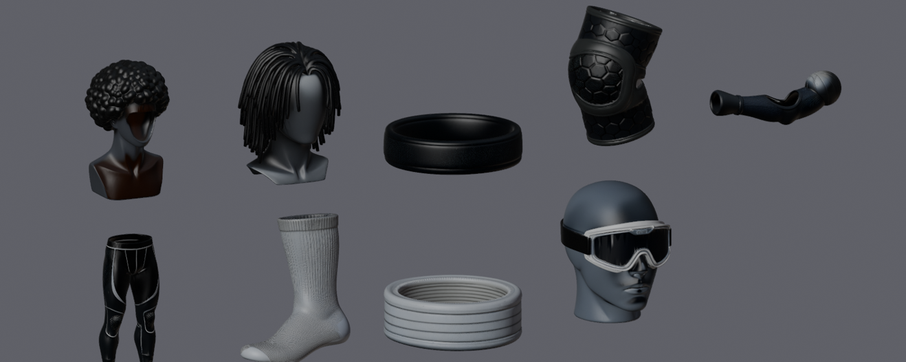
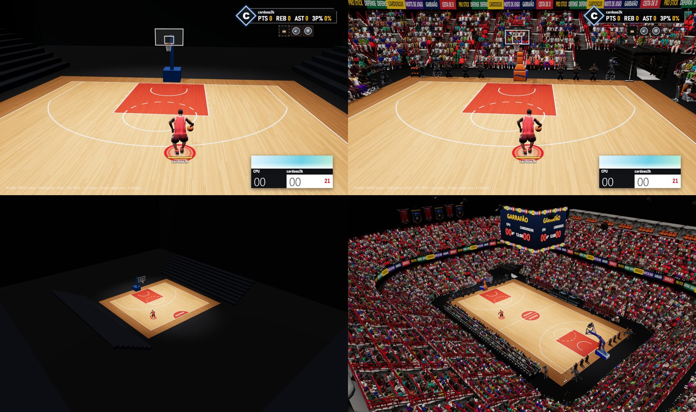
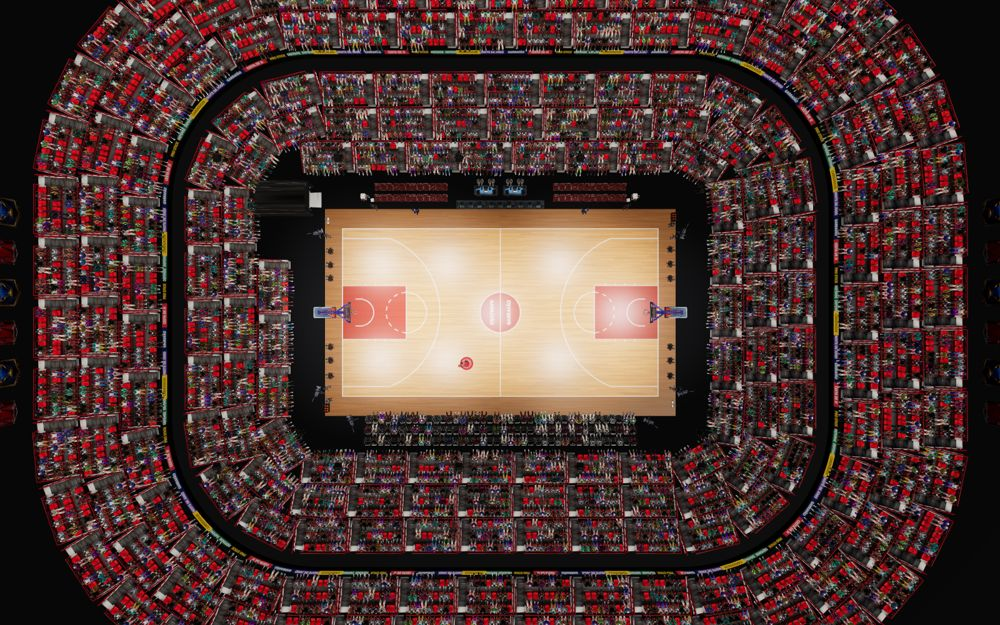
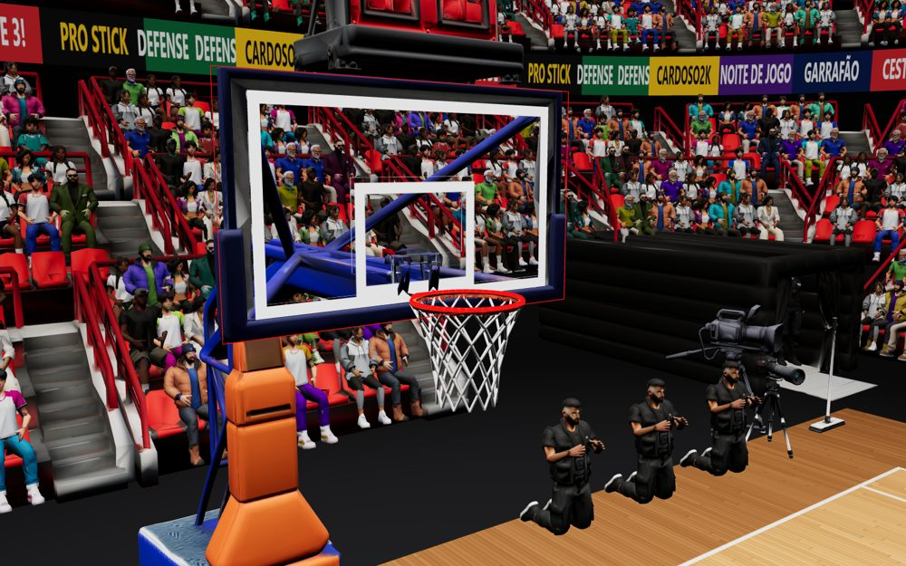

# 20 — Modelos 3D: tênis, uniforme e partes do jogador (HY 3D Studio)

Gerados no Tencent HY 3D Studio (Hunyuan3D v3.1) pela skill `hy3d-studio`, em 15/10/2026, com 3 contas em paralelo
(30 créditos no total). **Uso interno, sem fins comerciais.** Os tênis seguem silhuetas de Jordans conhecidos e, mesmo
com `no logos` no prompt, a textura do HY **pintou swoosh e Jumpman** em vários deles (e um swoosh grande na bermuda
branca). Para vender o jogo, todos os tênis e essas texturas precisam ser trocados por desenhos próprios.



## O que está no jogo

| Arquivo (`web/public/assets/gear/`) | Base | Triângulos |
|---|---|---|
| `tenis_retro_alto_1.glb` | AJ1 High "Chicago" | 5k por pé |
| `tenis_verniz_11.glb` | AJ11 (saiu mais genérico: preto e azul-gelo) | 5k por pé |
| `tenis_cimento_4.glb` | AJ4 "Cement" | 5k por pé |
| `tenis_elefante_3.glb` | AJ3/AJ4 preto, vermelho e cimento | 5k por pé |
| `tenis_baixo_moderno.glb` | low-top atual, marinho e verde-neon | 5k por pé |
| `regata_vermelha.glb`, `bermuda_vermelha.glb` | kit da casa (`regata_nova`, `bermuda_nova`, 16/10) | 9k cada |
| `regata_branca.glb`, `bermuda_branca.glb` | kit visitante (mesmas formas, outra textura) | 9k cada |
| `../hoops_player.glb` (malha `Jogador`) | corpo `jogador_branco` (rig do HY), no esqueleto e com os clipes do boneco | 15k |

URL: padrão = kit vermelho + AJ1. `?uniforme=branco`, `?tenis=tenis_cimento_4` (nome do arquivo), `?roupa=0` (boneco liso).

Gerados, ainda **não usados** (em `models_raw/`): `jogador_pivo` (o corpo negro de 15/10, com regata cinza pintada no
tronco: sai pelo mesmo comando, sem `--sem-regata`), `jogador_armador` (mangas pretas que apareceriam sob a regata),
`cabeca_jogador` (busto; o lado da cabeça veio pintado de azul), `mao_aberta` e a regata/bermuda de 15/10.

### Lote de 16/10 (11 créditos): jogador branco e uniforme novo
O usuário reprovou a primeira regata ("nem parece regata", ombro quebrado, braço atravessando) e as cores do corpo negro
(a regata cinza do HY repintada de pele lisa ficava com outro tom), e pediu jogador branco como padrão. Gerados:
`jogador_branco` (geometria sem camisa e descalço; a 1ª textura pintou um colante preto e batom e foi refeita descrevendo
só a pele), `regata_nova` + `regata_nova_branca` (mesma geometria, 2ª textura) e `bermuda_nova` + `bermuda_nova_branca`.
A moderação do HY recusa "invisible body", "shirtless", "bare chest" (erro 200006, sem custo); os textos aceitos estão na
skill `hy3d-studio`.

## O corpo do jogador (`Tools/Animacao/trocar_corpo.py`)



O boneco de tubos deu lugar ao corpo do HY (hoje `jogador_branco`) **sem mexer no esqueleto nem nos clipes**: os 31 ossos,
as matrizes de bind e os 38 clipes saem iguais aos do GLB antigo (o `hoops_player.clips.json` continua valendo) e a altura
do bind é a mesma (1,715 m → escala do jogo 1,0846, como antes). Quem se ajusta é a malha:

```bash
blender -b -P Tools/Animacao/trocar_corpo.py -- <hoops_player.glb com os clipes> web/public/assets/models_raw/jogador_branco_rig.fbx web/public/assets/hoops_player.glb --sem-regata
```

- **Conferir os tempos dos clipes** depois de exportar: o importador de FBX troca a cena para 24 quadros/s (a taxa do FBX
  do HY) e, sem voltar a 60 antes do export, os clipes saíam 2,5x mais lentos que o clips.json (o arremesso soltava a bola
  com o braço na cintura). O script volta a cena para 60; confira o `max` do accessor de tempo de cada animação.

- Usa o `*_rig.fbx` do `bone_skinning` (malha texturizada com pesos no esqueleto do HY). Escala para a altura do boneco e
  dá a cada osso do HY uma transformação que leva as juntas dele às do boneco: braços de A para T, pernas abertas ~25°,
  cada segmento esticado ao comprimento do osso da CMU; a malha segue pelos pesos do HY.
- **Braço** (16/10, o usuário achou o braço "quebrado, pontiagudo"; antes e depois em `img/braco-antes-depois.png`):
  - o esqueleto da CMU tem o braço direito com 30,5 cm em cima e 17,7 cm de antebraço (o esquerdo, 28,6 e 19,9) e o ombro
    direito 2,6 cm mais para dentro. Mudar o esqueleto mexeria nos clipes e no `clips.json` (palma por quadro, usada no
    drible), então quem se ajusta é a malha;
  - o braço e o antebraço engrossam com a raiz do estiramento (`thicken`): o braço de cima esticado ~30% ficava um
    macarrão comprido;
  - o ombro da malha é simétrico, na largura do ombro mais largo (`shoulder_target`); o osso continua girando na junta da
    CMU, dentro do deltoide;
  - a redução protege a pele que fica à mostra (braços, mãos, cabeça, pescoço, canelas; `DETAIL`): com só rosto e mãos
    protegidos o braço ficava facetado e o cotovelo dobrava numa ponta.
- Tronco: estica 1,15× na vertical entre quadril e ombro e cisalha em Y (no HY os ombros ficam 5 cm atrás do quadril; sem
  isso as costas ficavam atrás do esqueleto e saíam da regata). Cabeça e pescoço só se deslocam.
- Pé só desloca até a sola tocar o chão do bind (o tornozelo do boneco fica a 4,5 cm do chão, o do HY a 9 cm: a canela do
  HY termina acima da junta). Mão rígida a 90% (a do HY tinha 21 cm).
- Ombros: a clavícula do HY desce (A-pose) e a do boneco sobe (T-pose, e a direita fica 1,7 cm mais alta que a
  esquerda); a mistura linear das transformações dobrava a pele no alto do ombro direito numa prega rasgada que furava a
  alça. O script suaviza o **deslocamento** (não a forma) na região da clavícula: o relevo do HY fica e a prega some.
- Pesos: Spine/Spine1/Spine2 → spine_01/02/03, Neck dividido em neck_01/neck_02, LeftHand → hand_l etc. **A mão inteira
  fica em `hand_*`**: nos clipes da CMU o `palm_*` e o `thumb_*` giram até 175–179° (dado ruim que a mão-tubo escondia;
  com dedos de verdade a mão virava do avesso). `palm_*`/`fingers_*` continuam no esqueleto para o jogo achar a palma.
- Redução 50k → 30k (com 15k–20k o tronco perdia o relevo do peito e do abdome ou o braço ficava facetado); cor em
  2048 px e normal em 1024 px (WebP). GLB de ~6 MB.
- **Rosto com textura própria** (material `Rosto`): a cabeça do HY está espalhada em dezenas de ilhas pelo atlas, então
  as faces dela ganham UV nova e a cor do atlas 4K original é passada para uma imagem de 1024 px só da cabeça (bake de
  emissão no Cycles). De perto, o rosto deixou de ser borrado.
- **Pele no jogo**: a arena ilumina de cima, com ambiente azulado e sem mapa de ambiente, e a pele saía cinza-arroxeada,
  com o rosto (que olha para baixo) escuro. `Pele` e `Rosto` levam emissão fraca e quente com a própria textura
  (0,22 / 0,19 / 0,17, imita a luz que atravessa a pele), rugosidade 0,65 e mapa de normal a 60%. O exportador do Blender
  não grava emissão tingida com textura: o script ajusta o JSON do GLB depois do export.
- Material `Pele` (textura). Num corpo que veio de camisa (o `jogador_pivo`), sem `--sem-regata` a regata do HY vira o
  material `Uniforme` cor de pele lisa; o `PlayerGear` não repinta o `Uniforme` quando a pele é textura.
- Depois de trocar o corpo, **vestir de novo as 9 peças** com o `vestir.py` (o encaixe usa a forma do corpo).

## Pipeline

1. **HY 3D** (`web/tools/hy3d-fila.js`, colado numa aba `hy3d.tencent.ai/robots.txt` logada): `text2geometry` 50k faces →
   `text2texture_v31` (PBR) [→ `bone_skinning` nos corpos]. A retopologia do site foi pulada: vivia em "servidor lotado"
   e o Blender reduz os polígonos. Uma conta roda até 5 tarefas; com 3 contas, as 13 peças saíram em ~25 min.
2. Baixar o GLB texturizado (22–45 MB, textura 4K) para `web/public/assets/models_raw/` (fora do git).
3. **Blender** (`Tools/Animacao/vestir.py`):
   ```bash
   blender -b -P Tools/Animacao/vestir.py -- web/public/assets/hoops_player.glb web/public/assets/models_raw/<peca>.glb <regata|bermuda|tenis> web/public/assets/gear/<peca>.glb
   ```
   Ordem: bermudas, depois regatas com `--por-cima-de=web/public/assets/gear/bermuda_<kit>.glb`, depois os tênis.
   - solda as costuras de UV e tira pedaços soltos pequenos (cordão, etiqueta);
   - **regata e bermuda ficam com uma camada só**: o HY gera tecido + avesso a milímetros e, depois da redução e do
     encaixe, o avesso furava o tecido em lascas (azuis no kit branco). Saem as faces viradas para dentro, medido a partir
     do eixo interno mais próximo (coluna e linha clavícula-ombro; quadril e coxas): no alto do ombro o "fora" é para cima
     (com a direção radial horizontal a alça ficava com as duas camadas). O jogo desenha a roupa dos dois lados;
   - encaixa a caixa da peça no corpo: regata do topo do ombro na pele (trapézio onde a alça passa, ~9 cm acima da junta
     do ombro: com a junta, as duas alças nasciam dentro do ombro) ao quadril, largura e fundura medidas até o peito; bermuda da cintura ao joelho (com as coxas endireitadas, como a peça gerada), tênis pelo pé descalço:
     calcanhar 1 cm atrás do calcanhar, comprimento +6%, largura +15%, sola na altura da sola (o jogo prega a sola no chão);
   - regata: pregas um pouco mais rasas (Smooth 12x); alças e decote assentados no ombro e no peito (a camada de dentro a
     0,7 cm da pele; o alvo inclui a base do pescoço); tudo empurrado para fora da pele e, com `--por-cima-de`, para fora
     da bermuda, por um campo suave com núcleo plano (o tecido vizinho recebe o mesmo empurrão), repetido até convergir;
     depois a faixa das alças é alisada e empurrada mais duas vezes (no ombro curvo as normais da pele divergem e o
     empurrão amassava a alça). Testados e descartados: deitar a alça de dentro para fora na pele (dobrava o pano) e
     empurrar na direção radial do eixo (perto do pescoço apontava para cima e inflava a alça);
   - **bermuda cortada ~1,5 cm acima da barra da regata**: o cós e a braguilha franzidos ficam escondidos e eram onde ela
     se dobrava sobre si mesma ao levantar a coxa (alisar, assentar ou refazer como casca da pele foram testados e
     descartados: amassavam as pregas ou estragavam a textura);
   - pesos: regata só no tronco (pelvis, spine_*, clavicle: a cava não acompanha o braço); onde cobre a bermuda, a barra
     copia os pesos dela e o pano balança só 20%. Bermuda: quadril acima da barra da regata, rampa de 20 cm até as coxas,
     esquerda/direita meio a meio numa faixa de ±17 cm (com a fronteira curta da pele, as pernas largas se cruzavam).
     Depois, média espacial dos pesos (5 cm na regata, 2,5 cm na bermuda); cria os ossos de pano `pano_*`; o tênis usa
     `foot`/`ball` e sai em par, com o esquerdo espelhado;
   - reduz para 9k (roupa) / 5k (tênis), sombreamento suave, textura 1024 px em WebP: 0,5–1 MB por GLB.
4. Conferência: `Tools/Animacao/ver_vestido.py` (corpo + peças, frente/lado/pé) e `Tools/Animacao/vitrine.py`.

## No jogo (`web/src/game/PlayerGear.ts`)

- A malha da peça é religada aos ossos do `PlayerAnimator` pelo nome. As matrizes de bind vêm do próprio GLB da peça
  (o importador do Blender usa `bone_heuristic='BLENDER'`, que preserva os eixos dos ossos do glTF).
- **Física do pano**: cada `pano_*` é um pêndulo verlet a 60 Hz (inércia, gravidade, mola de volta ao repouso, ângulo
  máximo). Regata solta (mola 55, até 55°), bermuda presa à coxa (pano com até 40% do peso, mola 140, até 28°). As pontas
  colidem com cápsulas das coxas, das canelas e do tronco, e a barra não entra na outra perna.
- **O corpo nunca atravessa a roupa** (`BodyCover.ts`): ao vestir, cada vértice do corpo lança um raio para fora; se bater
  numa peça a menos de 12 cm, o vértice está coberto. Também conta como coberto o vértice cujo raio para **dentro** bate na
  peça a menos de 4 cm (a pele furou o tecido). A máscara é erodida um anel (a pele continua um pouco sob a barra e o
  decote, e o recorte serrilhado não aparece pela fresta) e os triângulos com 2+ vértices cobertos saem do índice (~1.800
  dos 15.000). Sem pele por baixo, nenhuma pose empurra o corpo através do tecido. A roupa é dupla face (pela cava aparece
  o avesso). Os raios usam uma grade espacial dos triângulos das peças (a carga do laboratório caiu de ~2,0 s para ~1,5 s).
  **Ombro**: pele de braço (osso dominante upperarm, lowerarm, hand…) só some sob um triângulo da peça que também segue
  aquele osso; a alça segue o tronco, então o deltoide que no bind (braços em T) ficava sob ela continua desenhado. E a pele
  coberta a até 2 anéis da pele de braço/clavícula que ficou também fica (`uncoverNear`): sem isso o recorte serrilhado do
  trapézio deixava uma fresta, e pelo ombro apareciam triângulos pretos (o avesso escuro da regata).
- **Membros nunca atravessam a roupa** (`LimbPush.ts`): o que o BodyCover não cobre (braço, antebraço, mão, joelho,
  canela) é resolvido no vertex shader da peça, depois da pele, a cada quadro. Cápsulas nos membros, com o raio médio
  medido no corpo + 1,2 cm, e uma esfera em cada joelho, com o raio da fatia do joelho incluindo a patela. Modo `in` (o
  membro passa por dentro da peça: coxa, joelho e canela na bermuda, ombro na regata): o tecido sai pela superfície,
  numa curva suave que começa 1,5 cm antes (sem lascas de triângulos esticados). Modo `out` (o membro cruza por fora: mão e
  antebraço na frente do corpo): o tecido recua para trás dele. Elipses no tronco e no quadril foram testadas e descartadas
  (abriam a gola e faziam pontas na barra). A coxa saiu da regata: a barra dela segue o quadril e a bermuda, e a cápsula
  da coxa a empurrava em lasca na corrida de lado; quem cobre a coxa é a bermuda.
- Conferência em movimento: `node web/tools/roupa-quadros.mjs <pasta> "?uniforme=vermelho"` (headless, 21 quadros de
  corrida de frente e de lado e dribles; `SEM_EMPURRAO=1` desliga o LimbPush para comparar).
- O 1º quadro depois de vestir chegava com dt negativo (o Chrome data o quadro antes do fim da tarefa longa de ~1 s), e o
  animador integrava para trás (mãos a 17 m). O `main.ts` limita o dt em [0; 0,1] s.
- O PBR do HY deixa o tecido com cara de plástico molhado: os mapas de rugosidade e de metal são descartados no pano.

## Lote "arena" (16/10/2026): 61 modelos para a quadra e a arena

Prompts em `web/tools/hy3d-lote-arena.mjs` (gera um `.js` por conta, com a divisão equilibrada de créditos; colar depois de
`hy3d-fila.js`). ~145 créditos nas 3 contas. Brutos em `web/public/assets/models_raw/arena/` (fora do git, ~2 GB): `<nome>.glb`
texturizado e, nas pessoas, `<nome>_rig.fbx` (rig do HY). Download: a aba imprime `<pasta da conta>|nome glb rig;...` e
`sh web/tools/hy3d-baixar.sh '<isso>'` baixa o que falta.





- **Cesta oficial**: base, braço, tabela, aro, shot clock e completa. A "base" e o "braço" vieram como estrutura inteira
  (o HY desenha a cesta toda mesmo pedindo uma peça só); a tabela, o aro e o shot clock saíram certos.
- **Volta da quadra**: mesa de anotação, cadeira e fileira do banco, cadeira e fileira VIP, mesa de transmissão, câmera de
  TV, câmera de fotógrafo, cooler, rack de bolas, bola HD, toalhas, rodo, prancheta, microfone e painel/púlpito de entrevista.
- **Arena (módulos para instanciar)**: bloco de arquibancada, camarote, telão central, faixa de LED, banners, refletor, túnel.
- **Pessoas (A-pose + rig)**: 10 torcedores, 2 árbitros, 2 técnicos, dançarina, fotógrafo, segurança, ball boy,
  comentarista. O **mascote** saiu sem rig: a A-pose padronizada e o `bone_skinning` do HY só aceitam humanoide padrão
  (`仅支持人形标准化`), e o mascote de cabeça grande não passa. Dá para riggar no Blender transferindo os pesos de um torcedor.
- **Acessórios**: munhequeira, faixa, manga de compressão, joelheira, meia-calça, meia, óculos e 3 cabelos (para o
  `vestir.py`). O afro, os dreads e os óculos vieram num busto de manequim (apagar a cabeça antes de vestir); a manga de
  compressão saiu estranha (gerar de novo).
- Mais fracos: telão central (saiu com "antenas" de cabo), camarote (caixa genérica), faixa de LED (vale fazer no jogo).
- Textos e logos: base da cesta completa ("FREMIN"), dígitos do shot clock e um swoosh no banner de camisa; trocar por
  textura nossa.

### A arena no jogo



**Otimização** (`Tools/Animacao/arena.py`, um GLB por item em `web/public/assets/arena/`, LFS pelo `*.glb`; 36 arquivos,
7,3 MB):

```bash
blender -b -P Tools/Animacao/arena.py -- web/public/assets/models_raw/arena web/public/assets/arena [nome ...]
```

- Escala real por item (mesa de anotação 1,15 m de altura, fileira VIP 3 m de largura, bloco de arquibancada 4,79 m...),
  frente para -Y no Blender (+Z no three) e origem no centro da base. Solda as costuras de UV antes de reduzir.
- Props 3–8k triângulos, cor + normal em 1024 px WebP; o metal/rugosidade do HY sai (material fosco). Arquibancada 2,5k e
  camarote 2k, só cor.
- Pessoas saem do `*_rig.fbx` numa pose fixa, com a pele aplicada e sem esqueleto: `sentado` (torcida, origem no apoio da
  coxa no assento), `mesa` (comentarista), `em_pe` com os braços baixos (técnicos, segurança, ball boy) e `ajoelhado`
  (fotógrafo). A pose aponta cada osso pela direção cabeça→cabeça do filho (a cauda do osso no FBX importado não aponta
  para a junta seguinte) com o "cima" no Z da armadura (o pescoço do HY fica ~8° atrás do quadril). Torcida 1,5k
  triângulos e cor em 512 px (são ~4 mil no anel); gente da volta da quadra 4k e 1024 px.
- Cesta: `cesta_estrutura` é a `cesta_completa` sem a tabela, o aro e a rede (tudo à frente da ponta do braço), com o
  braço esticado 0,5 m (na escala do modelo a base encostava na linha de fundo). `cesta_tabela` perde os dois aros que o
  HY desenhou (um de cada lado) e é escalada para 1,83 x 1,07 m; as faces do vidro viram o material `Vidro`. `cesta_aro`
  perde a moldura e a rede, é escalado pelo diâmetro externo da física (45,7 cm + tubo) e a placa é esticada até a face
  da tabela (15,1 cm). Não entraram: telão e faixa de LED (feitos no three.js), árbitros, dançarina, mascote, bola HD,
  prancheta, microfone, painel/púlpito, cadeiras soltas e os acessórios.

**No jogo** (`?arena=0` desliga tudo e volta à quadra antiga):

- `HoopMesh.buildModelHoop`: tabela na face da física (`backboardFaceCenter`), aro no `rimCenter()`, relógio de 24 s em
  cima e a estrutura nas costas da tabela. Só visual: a colisão e a rede (`NetMesh`) são as mesmas. O vidro é
  transparente e a pintura (borda e quadrado com a base na altura do aro) vem de um canvas do tamanho do vidro do modelo.
  Se algum GLB não carregar, cai no `buildHoop` antigo. Conferência: `node web/tools/arena-prints.mjs <pasta>` gera
  `cesta.png`/`cesta-lado.png` com o aro e a face da física em arame vermelho por cima.
- `ArenaDressing.ts` (posições da `game.layout`): a outra metade da quadra (o canvas do piso girado 180° em torno do
  centro, como numa quadra de verdade) e a cesta do outro lado com rede parada; mesa de anotação (3 módulos) no meio da
  lateral -y, transmissão com 4 comentaristas atrás, bancos dos dois times (2 fileiras de 2 módulos), técnicos de pé,
  cooler e toalhas; 3 fileiras VIP na lateral +y (a 2ª e a 3ª em degrau) com ~75% de gente; 6 fotógrafos ajoelhados e
  2 câmeras remotas sob cada cesta, câmeras de TV nos cantos, rack de bolas, rodo, ball boy, seguranças e o túnel no canto
  dos bancos.
- Arquibancada: 6 anéis de `bloco_arquibancada` num retângulo de cantos arredondados (218 blocos, InstancedMesh por
  lado da arena para o corte por frustum), recuo entre o 3º e o 4º anel com a faixa de LED (canvas que corre),
  camarotes no topo das laterais, 12 banners atrás das linhas de fundo, refletores no teto e o telão central (placar em
  canvas). Torcida: ~4.100 pessoas sentadas, uma InstancedMesh por lado e modelo; o shader gira o matiz das roupas por
  instância (a pele fica: vermelho > verde > azul com saturação de pele) e clareia/escurece o resto, com um pouco de luz
  própria (a arquibancada fica na penumbra). 7,2 M triângulos na arena, 96 malhas; 60 FPS no headless (RX 9070 XT).
- Os GLBs começam a baixar junto com o jogador e os shaders são compilados antes do 1º quadro (`compileAsync`).




## Pendências
- Arena: torcida sem animação (próximo passo: VAT); cantos da arquibancada com blocos girados sobrepostos (um bloco de
  canto próprio fecharia); dígitos do shot clock e o placar do telão são estáticos; GPUs fracas podem precisar de menos
  anéis ou menos torcida.
- Pele: com a emissão o tom ficou claro e quente, mas um pouco brilhante na testa e no nariz de perto; ajustar com a
  iluminação final da arena (a sessão da arena mexe nas luzes).
- Regata: riscos finos na metade de baixo (sombra das pregas da textura). A alça amassada em cima do ombro (16/10) foi
  corrigida: era a prega do ombro direito no corpo e o topo da regata abaixo do trapézio.
- Bermuda: ao correr, um recorte pequeno no alto da perna levantada (as pregas da perna). Peças desenhadas para o jogo
  (sem pregas fundas na geometria, dobras só na textura) resolveriam de vez.
- Texturas próprias, sem marca, antes de qualquer distribuição.
